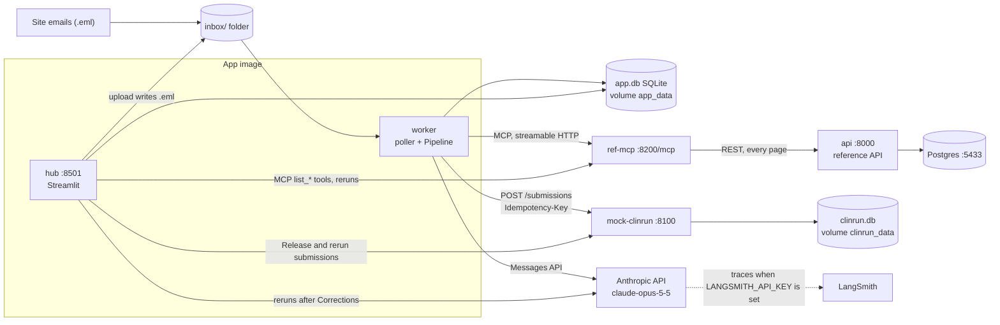
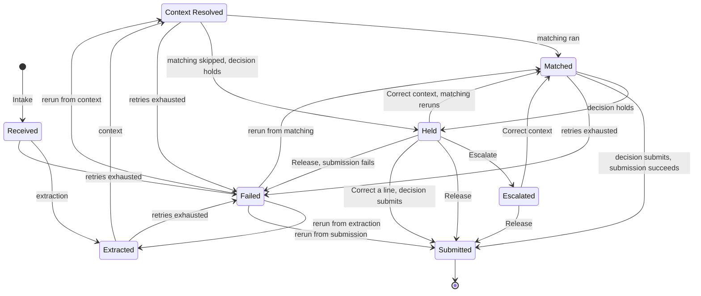
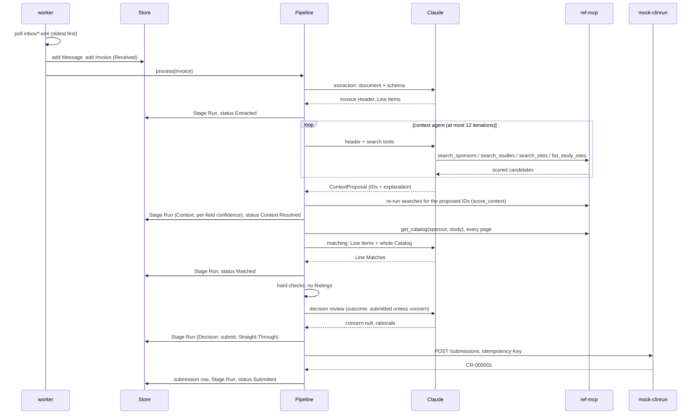
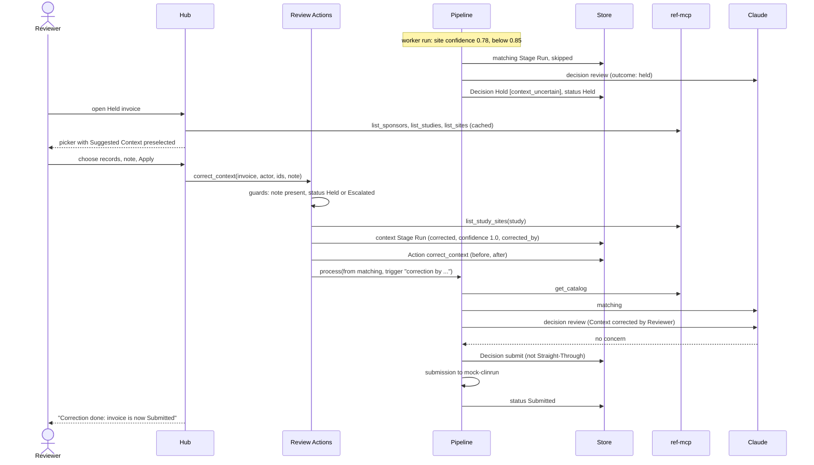
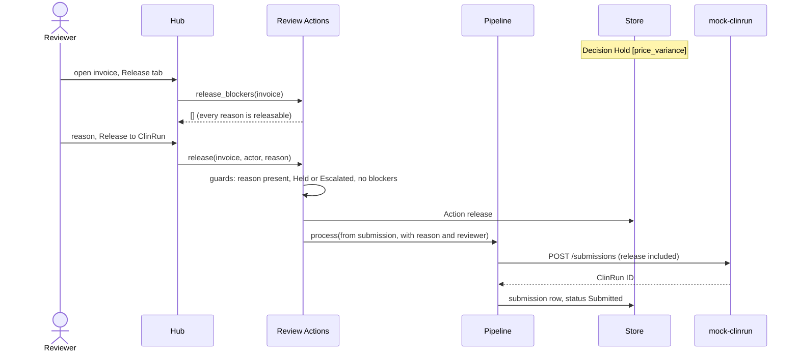
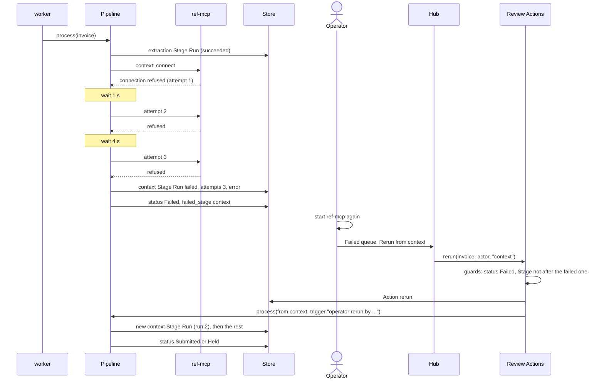

# Architecture

How the system is built, as it is in the code. Terms are defined in [GLOSSARY.md](../GLOSSARY.md);
the reasons behind each choice are in [decisions.md](decisions.md) and [adr/](adr/).

## High-level architecture

Six Compose services. The worker and the Hub run from the same app image and share one SQLite file.

Two points the diagram makes explicit:

- **Reruns run in the Hub process.** A Correction, Release or Operator rerun calls the Pipeline
  synchronously from the Hub (behind a spinner), so the Hub also talks to ref-mcp, Claude and
  ClinRun. The worker handles only new Invoices from the inbox.
- **The app speaks only MCP to the reference data.** The context agent, the score computation, the
  Catalog fetch and the Hub's Correction picker all go through ref-mcp
  ([ADR-0003](adr/0003-mcp-server-owns-reference-search.md)).

## Low-level architecture

### Modules

| Module | Interface | Hides |
|---|---|---|
| `intake.py` | `parse_eml(path) -> Message` with `InvoiceFile`s or a `rejection_reason`; `write_upload(inbox, filename, media_type, data, uploaded_by) -> Path` | Email parsing, keeping only PDF/PNG/JPEG attachments, the rejection reason, the file's SHA-256, the `X-Invoice-Source: upload` marker |
| `extraction.py` | `extract(data, media_type) -> Extraction` | The prompt, the document or image block, the schema, setting `source_media_type` |
| `context.py` | `resolve(header) -> Context`; `catalog(sponsor_id, study_id) -> list[dict]`; `score_context(call, header, proposal)`; `Reference.load()`, `Reference.study_sites(study_id)` | The MCP session, the tool-runner agent restricted to the search tools, reading MCP results (ISSUE-002), the per-field score and thresholds, the link and ownership checks |
| `matching.py` | `match(lines, catalog) -> Matching` | The prompt and the payload (whole Catalog, every Line Item) |
| `decision.py` | `decide(extraction, context, matching or None, catalog, review=llm_review) -> Decision` | The four hard checks (`HARD_CHECKS`), exact money with half-up rounding, the tolerance and $0.00 rule, the LLM review, and computing the outcome in code |
| `pipeline.py` | `Pipeline(store, stages, backoff).process(invoice_id, from_stage, trigger, release) -> status`; `Stages` (injectable Stage functions) | Stage order, skipping matching when the Context is uncertain, two retries with backoff (1 s, 4 s), Failed with the failed Stage, recording Stage Runs with their inputs, status changes, building the ClinRun submission |
| `review.py` | `ReviewActions(store, pipeline, reference)`: `correct_context`, `correct_line`, `release`, `escalate`, `rerun`, `release_blockers`; raises `ActionRefused` | Every guard (status, required notes, Release eligibility, rerun limits), run before anything is written; writing the corrected Stage Run and the Action; carrying a Release into a submission rerun |
| `store.py` | `Store(path)`: `add_*`, `set_status`, `set_control`/`control`, `latest_run`, `latest_output`, `stage_runs`, `actions`, `invoices`, `rejected_messages`, `submission` | The SQLite schema, WAL mode for the Hub reading while the worker writes, run numbering |
| `clinrun.py` | `idempotency_key(sha256, version)`; `submit(submission, key) -> clinrun_id` | HTTP and the `Idempotency-Key` header |
| `llm.py` | `parse(output, system, content, effort)`; `client()`, `async_client()`; `served_by`, `record_served`; `LLMRefusal` | SDK options (structured outputs, effort, refusal fallbacks), the LangSmith wrapper, recording which model served a call |
| `worker.py` | `ingest(store, path)`, `poll_once(store, pipeline, inbox)`, `main()` | The poll loop, oldest-first by file time, moving files to `processed/`, the pause and check-now flags |
| `hub.py` | A Streamlit page | Layout, auto-refreshing fragments, one Store connection per browser session, the one error boundary |
| `metrics.py` | `summary(store, minutes_per_invoice, minutes_per_line) -> dict` | The queries and the manual baseline arithmetic |
| `config.py`, `models.py` | `settings`; pydantic models, `HoldReason`, `InvoiceStatus`, `RELEASABLE` | Environment parsing; schemas |
| `services/ref-mcp` | Tools `search_sponsors`, `search_studies`, `search_sites`, `list_study_sites`, `get_catalog`, `list_sponsors`, `list_studies`, `list_sites` | REST paging to the end (`refapi.fetch_all`, with a row-count check), rapidfuzz scoring and name normalisation (`scoring.py`) |
| `services/mock-clinrun` | `POST /submissions`, `GET /submissions`, `GET /submissions/{clinrun_id}`, `GET /health` | Its own SQLite file, idempotency by key |
| `evals/` | `python -m evals.run_eval`; `scoring.score`, `scoring.gate` | Uploading the dataset to LangSmith, running the experiment, comparing with the gold labels |

### Data model (app store)

From [`store.py`](../src/invoice_assist/store.py). Stage outputs are stored as JSON in
`stage_runs.output`; there are no separate tables for Extractions, Contexts, Matchings or Decisions.

| Table | Columns | Notes |
|---|---|---|
| `messages` | `id`, `message_id`, `source` (`inbox` or `upload`), `sender`, `subject`, `body`, `received_at`, `rejection_reason`, `created_at` | A Rejected Message is a row with `rejection_reason` set and no Invoices |
| `invoices` | `id`, `message_id` → messages, `filename`, `media_type`, `sha256`, `data` (the file), `version` (default 1), `status`, `failed_stage`, `created_at`, `updated_at` | `status` and `failed_stage` are the only fields updated in place |
| `stage_runs` | `id`, `invoice_id`, `version`, `stage`, `run_no`, `trigger`, `outcome` (`succeeded`/`failed`), `inputs` (JSON: IDs of the Stage Runs read), `output` (JSON), `error`, `served_by` (models), `attempts`, `started_at`, `ended_at` | Append-only. The current state of a Stage is its latest succeeded run for the Invoice's version |
| `submissions` | `id`, `invoice_id`, `version`, `clinrun_id`, `idempotency_key`, `sent_at` | The Hub reads the latest row |
| `actions` | `id`, `invoice_id`, `actor`, `kind` (`correct_context`, `correct_line`, `release`, `escalate`, `rerun`), `note`, `before`, `after` (JSON), `at` | Append-only audit trail |
| `control` | `key`, `value` | Operator flags: `paused`, `check_now`, `last_poll` |

Stage Run triggers: `automatic`, `correction by <actor>`, `release by <actor>`,
`operator rerun by <actor>`, and `eval` from the eval runner.

### Status lifecycle

Statuses are set by `Pipeline.process` and `ReviewActions.escalate`. There is no separate "Decided"
status: after the decision Stage the Invoice is either Held or goes on to submission.

Notes on the diagram:
- A context Correction writes the corrected context Stage Run directly and reruns from matching, so
  the status goes from Held (or Escalated) to Matched, then to Held or Submitted.
- A line Correction reruns from the decision Stage, which sets no status of its own: the Invoice
  stays Held (with the new reasons) or moves to Submitted. Each of these can also end in Failed.
- An Operator rerun resumes at the chosen Stage (the failed one or earlier), and the status follows
  the Stages that run from there.
- Amendment Pending and Amended (P2) are not built; a Submitted Invoice cannot be corrected.

## Sequence diagrams

### 1. Happy path: email to Submitted

### 2. Uncertain Context: Hold, Correct Context, rerun, Submitted

### 3. Release of a Price Variance

### 4. Stage failure, retries, Failed, Operator rerun

## Decision logic

`decide()` runs every hard check, then the LLM review, then computes the outcome
([ADR-0002](adr/0002-llm-can-add-holds-never-clear-them.md) and its amendment).

**Hard checks** (each a pure function with the same signature, in `HARD_CHECKS` order):

| Check | Hold Reason | Fires when |
|---|---|---|
| `check_source` | `extraction_unverifiable` | The Invoice is an image (no text layer to check numbers against) |
| `check_context` | `context_uncertain` | Any of sponsor, study, site is not confident; or the study does not belong to the sponsor; or matching did not run and nothing else explains it |
| `check_context` | `site_not_linked` | The site is not linked to the study |
| `check_arithmetic` | `arithmetic` | A line's quantity × unit price differs from its amount; no printed total; or the lines do not sum to the printed total. Money is `Decimal`, rounded half up to the cent |
| `check_matches` | `unmatched` | A Line Item has no match, or the matcher left it out of its answer (the check iterates the Line Items, not the matcher's list) |
| `check_matches` | `ambiguous` | The match is marked ambiguous, or its confidence is `low` |
| `check_matches` | `price_variance` | `abs(billed − catalog) > catalog × PRICE_TOLERANCE`. A $0.00 Catalog price is taken literally, so any billed amount is a variance; billing below the Catalog price is also a variance |

**LLM review rule.** The review always runs, because it writes the rationale. It receives the
findings and the outcome they determine. If it returns a `concern`, an `llm_concern` finding is
added. The outcome is `hold` when there is any finding, `submit` otherwise; the review cannot remove
a finding. `straight_through` is true only for a submit, and the Pipeline sets it false if the
Invoice has any `correct_*` Action.

**Release eligibility.** `RELEASABLE` = `price_variance`, `unmatched`, `ambiguous`, `llm_concern`,
`extraction_unverifiable`. Release is allowed only when every Hold Reason is in that set.

## Context Confidence computation

In `context.score_context` ([ADR-0004](adr/0004-context-confidence-is-computed.md),
[ADR-0005](adr/0005-corroboration-ranks-but-cannot-lift.md)), using ref-mcp's scores
(`services/ref-mcp/scoring.py`, rapidfuzz, all in 0..1, rounded to 3 places):

| Field | Score used | How ref-mcp computes it |
|---|---|---|
| Sponsor | `search_sponsors(sponsor_name)` → `score` of the proposed sponsor | `token_set_ratio` after lower-casing, dropping punctuation and corporate suffixes (Inc, LLC, Ltd, Corp, …), and folding "pharmaceutical(s)" to "pharma" |
| Study | Best of `search_studies(protocol_number)` and `search_studies(study_name)`, scoped to the proposed sponsor → `score` of the proposed study | `max(name_score, protocol_score)`; the protocol score is a character-level `ratio`, so a wrong year scores high but below 1.0 |
| Site | `search_sites(site_name, pi_name)` → `name_score` of the proposed site | `token_set_ratio` on the normalised name. The PI score only affects `rank_score`, the ordering key, never the reported score |

A field is `confident` when a record was proposed and its score ≥ `THRESHOLD_<FIELD>` (0.85). A
proposed record not among the top 20 search results scores 0. `site_linked_to_study` comes from
`list_study_sites`; `study_belongs_to_sponsor` from the study's `sponsor_id`. A Reviewer's
Correction sets each chosen field to confidence 1.0 and recomputes both checks from the reference
data.

## Idempotency

- **Key:** `sha256("<file sha256>:v<version>")` (`clinrun.idempotency_key`), sent as the
  `Idempotency-Key` header.
- **mock-clinrun:** a repeated key returns the original ClinRun ID with `"duplicate": true` and HTTP
  200, and stores nothing new. The key column is `UNIQUE`.
- **Effect:** a retry, a rerun from submission, or the same PDF arriving again in a new email never
  creates a second ClinRun submission. The app store does record a second Invoice for a re-sent
  email (Possible Duplicate detection is P2), and a rerun from submission adds a second
  `submissions` row with the same ClinRun ID (deferred as harmless).
- **Not covered:** two concurrent first submissions of the same key could race in mock-clinrun; the
  worker is sequential, so this is not planned.

## Where each ADR shows up in code

| ADR | Code |
|---|---|
| [0001](adr/0001-no-human-gate-hold-on-uncertain-context.md) No gate; hold on uncertain Context | `Pipeline._run`: `if not ctx.confident: return {"skipped": True, ...}`; `decision.check_context` |
| [0002](adr/0002-llm-can-add-holds-never-clear-them.md) LLM adds Holds, never clears | `decision.decide`; test `test_llm_cannot_clear_a_hard_check_hold` |
| [0003](adr/0003-mcp-server-owns-reference-search.md) MCP server owns search | `services/ref-mcp/server.py`, `refapi.fetch_all`; `context.AGENT_TOOLS` |
| [0004](adr/0004-context-confidence-is-computed.md) Computed confidence | `context.score_context`, `config.threshold_*`; the agent prompt's "Do not state how confident you are" |
| [0005](adr/0005-corroboration-ranks-but-cannot-lift.md) Corroboration ranks, cannot lift | `scoring.site_rank_score`; `search_sites` keeps `score = name_score`; `score_context` reads `name_score` |
| [0006](adr/0006-whole-catalog-in-one-matching-call.md) Whole Catalog, one call | `matching.match`; `get_catalog` fetching every page |
| [0007](adr/0007-native-pdf-extraction-with-text-check.md) Native extraction | `extraction.extract` (document or image block); `decision.check_source` for images. The text-layer number check is P2, not built |
| [0008](adr/0008-fixed-stages-one-agent-loop.md) Fixed Stages, one agent loop, Anthropic SDK | `pipeline.STAGES`; `context._propose` (the SDK tool runner) is the only loop; `llm.py` |
| [0009](adr/0009-failed-is-not-held.md) Failed is not Held | `Pipeline._attempt` (backoff `(1, 4)`), `_Exhausted` → status Failed with `failed_stage`; `ReviewActions.rerun` |
| [0010](adr/0010-amend-never-withdraw.md) Amend, never withdraw | Only the refusal: `ReviewActions._held` rejects a Submitted Invoice ("Amendments (P2)"). Amendments are not built |
| [0011](adr/0011-mock-clinrun-idempotent.md) Idempotent mock ClinRun | `clinrun.idempotency_key`, `services/mock-clinrun/app/main.py` `submit` |
| [0012](adr/0012-eval-gate-zero-false-submits.md) Zero False Submits gate | `evals/scoring.py` `GATE` and `gate`; `evals/run_eval.py` exit codes |
