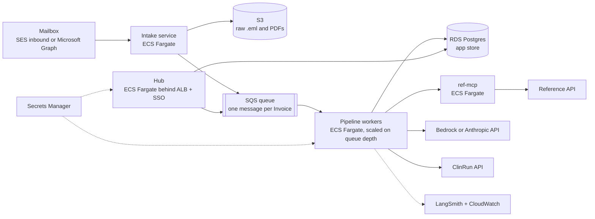
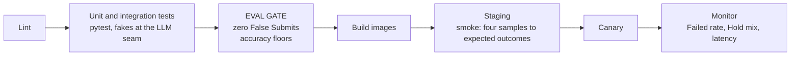

# Deployment

The system runs locally as one Docker Compose stack. The AWS design at the end is the production
story; none of it is built.

## Local: Docker Compose

```bash
cp .env.example .env          # set ANTHROPIC_API_KEY; LANGSMITH_API_KEY is optional
docker compose up -d --build
docker compose ps             # six services; db reports (healthy)
```

| Service | Image | Port | State |
|---|---|---|---|
| `db` | `postgres:17-alpine` | 5433 | volume `postgres_data` |
| `api` | `services/api` (starter, unchanged apart from the ISSUE-001 pin) | 8000 | Truncates and reseeds the reference data on every start |
| `ref-mcp` | `services/ref-mcp` | 8200 (`/mcp`) | Stateless |
| `mock-clinrun` | `services/mock-clinrun` | 8100 | volume `clinrun_data` (`/data/clinrun.db`) |
| `worker` | root `Dockerfile`, default command `python -m invoice_assist.worker` | none | volume `app_data` (`/data/app.db`), bind mount `./inbox` |
| `hub` | root `Dockerfile`, command `streamlit run src/invoice_assist/hub.py` | 8501 | same volume and mount as the worker |

Startup order comes from `depends_on`: `api` waits for a healthy `db`; `ref-mcp` starts after `api`;
`worker` after `ref-mcp` and `mock-clinrun`; `hub` after `worker`. Only `db` has a health check, so
`ref-mcp` can be up before the API has finished seeding. A context Stage that hits that window is
retried, and becomes Failed if the API is still down after three attempts. No service has a
`restart:` policy.

`worker` and `hub` read `.env` if it exists (`required: false`), so the stack starts without it, but
every LLM call fails until `ANTHROPIC_API_KEY` is set.

### Running the worker and Hub natively

For a faster loop, run only the backing services in Compose and the app on the host. The defaults in
`config.py` already point at `localhost`:

```bash
docker compose up -d db api ref-mcp mock-clinrun
docker compose stop worker hub         # if they are running: both would watch ./inbox
source .venv/bin/activate              # see README: uv sync
python -m invoice_assist.worker        # REF_MCP_URL=http://localhost:8200/mcp, CLINRUN_URL=http://localhost:8100
streamlit run src/invoice_assist/hub.py
```

Natively the app store is `data/app.db` and the inbox is `./inbox` (`APP_DB`, `INBOX_DIR`). That
store is separate from the container's `app_data` volume, so Invoices processed in one mode are not
visible in the other. mock-clinrun is still the container, so ClinRun IDs carry on from either mode.

### Resetting state

| To reset | Command |
|---|---|
| Everything (reference data, ClinRun, app store) | `docker compose down -v`, then `docker compose up -d` |
| App store and ClinRun only | `docker compose down`, `docker volume rm lr-emailassist_app_data lr-emailassist_clinrun_data`, then `docker compose up -d` (the volume prefix is the Compose project name; check with `docker volume ls`) |
| Reference data | `docker compose restart api` (the entrypoint truncates and reseeds) |
| The inbox | delete `inbox/processed/*.eml`; files left in `inbox/` are processed on the next poll |
| A native store | delete `data/app.db` |

## Production design on AWS (not built)

The local stack maps onto managed services one to one; the Pipeline, Review Actions and the
decision rules do not change.



| Concern | Local | Production |
|---|---|---|
| Intake | `.eml` files in a polled folder | SES inbound to S3, or a Microsoft Graph subscription, behind the same Intake interface |
| Processing | One worker, one Invoice at a time | SQS queue with one message per Invoice; Fargate workers scaled on queue depth. Reruns from the Hub become queue messages instead of running in the Hub process |
| App store | SQLite on a volume | RDS for PostgreSQL; the schema stays append-only for Stage Runs and Actions |
| Reference data | ref-mcp in front of the starter API | ref-mcp as a Fargate service in front of the real reference data |
| LLM | Anthropic API, `claude-opus-5-5` | Bedrock or the Anthropic API; the model stays a configuration value checked by the eval gate |
| ClinRun | mock-clinrun with idempotency keys | The real ClinRun API; the same idempotency key per Invoice Version, and Amendments (P2) |
| Secrets | `.env` | Secrets Manager, injected into task definitions |
| Identity | "Acting as" picker | SSO in front of the Hub, with roles enforced in Review Actions |
| Observability | Stage Runs in SQLite, optional LangSmith | LangSmith for LLM traces and evals; CloudWatch for logs, metrics (queue depth, Failed count, Stage latency) and alarms |

### CI/CD



The eval gate is `python -m evals.run_eval`, which exits non-zero when any False Submit occurs or a
metric falls below its floor ([ADR-0012](adr/0012-eval-gate-zero-false-submits.md)). It needs the
stack, an Anthropic key and a LangSmith key, so in CI it runs against a staging-like environment. A
prompt, model or threshold change goes through the same gate as a code change. None of this
pipeline exists in the repository today; tests and evals are run by hand.
